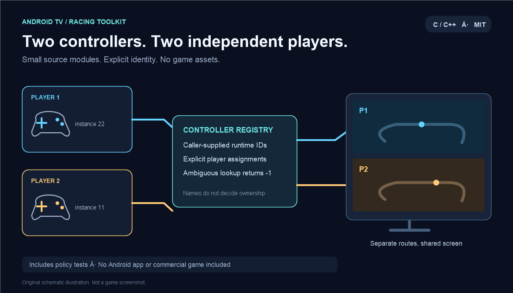

# Android TV Racing Toolkit — česky

Samostatné vývojářské moduly vzniklé při ladění dvou ovladačů na Android TV. Nejde o celou hru ani instalační APK.

Obsahuje registr instancí dvou gamepadů pro SDL2, filtr směrového kříže pro potvrzování menu, časování zpomalování podle aktivního času a náhodný okamžik první herní události podle odjeté části závodu.

Kód registru potřebuje, aby aplikace předala platné a jednoznačně přiřazené SDL instance. Samotný registr nepoznává ovladače podle jména a neobnovuje uložené Android identity. Příklady a omezení najdeš v [integračním návodu](docs/INTEGRATION.md).

Obrázky jsou vlastní schémata, nikoli herní screenshoty. Herní engine, data, zvuky, grafika, upravené APK a soukromé diagnostické údaje nejsou součástí repozitáře. [Původ a rozsah zveřejnění](PROVENANCE.md).

Testy lze spustit přes CMake/CTest nebo `python tools/run_tests.py`. Testy používající náhradu SDL ověřují pravidla přiřazení, nikoli skutečný hardware či souběh vláken.

Licence tohoto balíčku: [MIT](LICENSE). Nic zde neuděluje práva k původní komerční hře.
