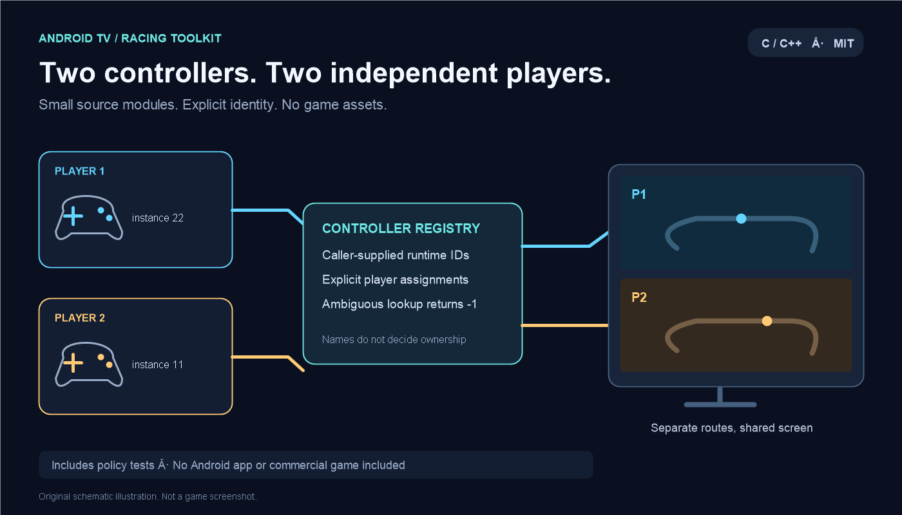
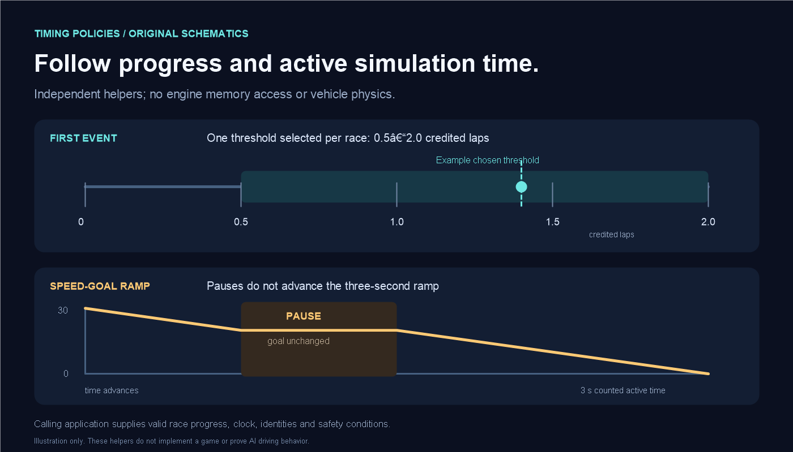

# Android TV Racing Toolkit

Small, asset-free C/C++ building blocks extracted from Android TV local-multiplayer compatibility work. **This is a developer toolkit, not a game, game port, emulator, or ready-to-install Android app.**



## What is included

| Module | Purpose | Dependency |
| --- | --- | --- |
| `ControllerIdentity.c/.h` | Filter runtime joystick instances into two logical player slots; reject ambiguous published bindings | SDL2 |
| `MenuConfirmMask.h` | Remove the four D-pad bits from a confirm-button mask in an explicitly compatible mapping | C++11 |
| `StopRamp.h` | Advance a desired-speed ramp using accumulated active time, with pause/duplicate/wrap handling | C++11 |
| `RandomArrival.h` | Choose a reproducible first-event threshold between 0.5 and 2 credited laps; handle two players and wrong-way debt | C++11 |

The `nfs_` prefixes are retained legacy identifiers. The modules contain no game memory addresses or engine access. They are not a complete police AI or a drop-in patch for a commercial game.

## Build and test

Default tests need CMake 3.16+, a C compiler and a C++11 compiler. No game, SDL2 download, or Android device is needed:

```sh
cmake -S . -B build -DBUILD_TESTING=ON
cmake --build build
ctest --test-dir build --output-on-failure
```

Alternatively, with Python 3 and compilers on PATH:

```sh
python tools/run_tests.py
```

For the real SDL2 registry library and the raw-input example, install SDL2 development files separately, then:

```sh
cmake -S . -B build-sdl -DRACING_TOOLKIT_WITH_SDL2=ON
cmake --build build-sdl
```

See [integration notes](docs/INTEGRATION.md) for preconditions, reconnect handling and limitations. SDL3 is not a drop-in dependency.

## Timing example



These are **original schematic illustrations**, not screenshots of a game. Geometry and labels were authored for this repository; no commercial game images, models, fonts, logos or textures are bundled.

## Evidence and limitations

Independent control of two physical wireless pads was user-confirmed during the original Android TV work. This extracted package was tested separately with deterministic software tests. Those tests do **not** emulate real USB/Bluetooth devices or prove Android hot-plug reliability.

The registry test uses a clearly labelled single-thread SDL API stub. It checks routing policy, not SDL locking correctness. The native-input example only prints raw events and deliberately avoids claiming a universal button layout.

The timing modules do not move cars, implement collisions, know any game's memory layout, or guarantee that an AI can stop a moving player. A calling application must validate its own geometry, lifecycle and input identity.

## License and scope

[MIT](LICENSE) for this repository's selected modules, tests, documentation and original illustrations. SDL2 is an external dependency under its own license; no SDL implementation is bundled.

No commercial executable, decompiled/recompiled engine, game data, music, track, car, texture, APK, binary patch, signing key, personal controller descriptor, private log or device address is included. See [provenance and redistribution scope](PROVENANCE.md).

This independent toolkit is not affiliated with or endorsed by a game publisher, SDL, or an Android TV manufacturer.

[Czech introduction](README.cs.md)
